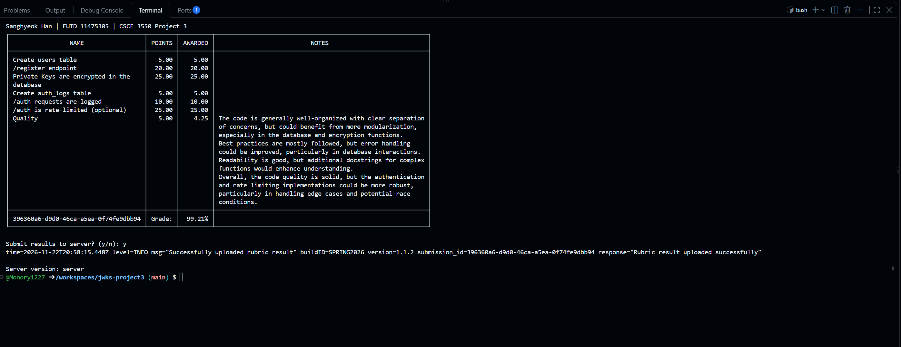
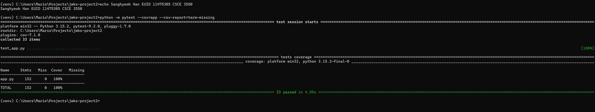

# JWKS Server (Project 3)

**Sanghyeok Han** | EUID 11475305 | CSCE 3550

A Flask JWKS server that serves public keys and issues RS256-signed JWTs. Project 3 adds protection for private keys and users:

- **Encrypted private keys:** RSA private keys are encrypted with AES-256-GCM before they are stored in the SQLite database. The AES key comes from the `NOT_MY_KEY` environment variable and is never written to the repo.
- **User registration:** `POST /register` creates a user with a generated UUIDv4 password, which is stored only as an Argon2id hash.
- **Auth logging:** every successful `POST /auth` is recorded in the `auth_logs` table (IP address, timestamp, user id).
- **Rate limiting:** `POST /auth` is limited to 10 requests per second. Extra requests get `429 Too Many Requests` and are not logged.

## Endpoints

| Method | Path | Description |
| --- | --- | --- |
| GET | `/.well-known/jwks.json` | Public signing keys in JWKS format |
| POST | `/register` | Body `{"username": "...", "email": "..."}`. Returns `201` with `{"password": "<uuid>"}`. `400` on bad input, `409` if the username or email is already taken. |
| POST | `/auth` | Returns a signed JWT. Add `?expired=true` to get a token signed with the expired key. Returns `429` when rate limited. |

## Database

SQLite file `totally_not_my_privateKeys.db` with three tables: `keys` (AES-encrypted private keys), `users` (Argon2id password hashes), and `auth_logs`.

## Setup and run

```
pip install -r requirements.txt
export NOT_MY_KEY="choose-a-long-random-secret"
python3 app.py
```

On Windows Command Prompt use `set NOT_MY_KEY=choose-a-long-random-secret` instead of `export`. The server listens on http://localhost:8080.

If you change `NOT_MY_KEY`, delete `totally_not_my_privateKeys.db` first, because keys stored under the old secret can no longer be decrypted.

## Tests

```
python3 -m pytest --cov=app --cov-report=term-missing
```

33 tests, 100% coverage of `app.py`.

## Security notes

- AES key: SHA-256 of `NOT_MY_KEY`; AES-256-GCM with a random 12-byte nonce stored in front of each ciphertext.
- Passwords: Argon2id (time cost 2, memory 64 MiB, parallelism 2, random 16-byte salt) stored as a PHC string.
- Secrets and local files (`.env`, `*.db`) are listed in `.gitignore`.

## Screenshots

Gradebot run (99.21%):



Test suite coverage (100%):

